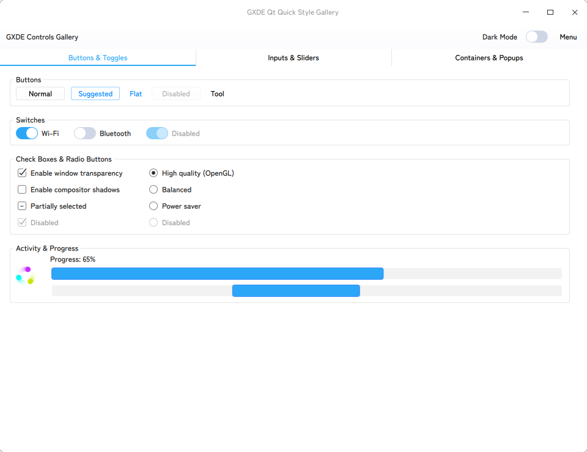

<!-- Improved compatibility of back to top link: See: https://github.com/othneildrew/Best-README-Template/pull/73 -->
<a id="readme-top"></a>
<!--
*** Thanks for checking out the Best-README-Template. If you have a suggestion
*** that would make this better, please fork the repo and create a pull request
*** or simply open an issue with the tag "enhancement".
*** Don't forget to give the project a star!
*** Thanks again! Now go create something AMAZING! :D
-->


<!-- PROJECT SHIELDS -->
<!--
*** I'm using markdown "reference style" links for readability.
*** Reference links are enclosed in brackets [ ] instead of parentheses ( ).
*** See the bottom of this document for the declaration of the reference variables
*** for contributors-url, forks-url, etc. This is an optional, concise syntax you may use.
*** https://www.markdownguide.org/basic-syntax/#reference-style-links
-->
[![Contributors][contributors-shield]][contributors-url]
[![Forks][forks-shield]][forks-url]
[![Stargazers][stars-shield]][stars-url]
[![Issues][issues-shield]][issues-url]
[![project_license][license-shield]][license-url]


<!-- PROJECT LOGO -->
<br />
<div align="center">
  <!--
  <a href="https://github.com/GXDE-OS/GXTK7">
    
  </a>
  -->

<h3 align="center">GXTK 7</h3>

  <p align="center">
    GXDE's Qt Quick UI plugin & component library.
    <br />
    <a href="./docs/html/"><strong>Explore the docs »</strong></a>
    <br />
    <br />
    <a href="https://github.com/GXDE-OS/GXTK7/actions">View CI Status</a>
    &middot;
    <a href="https://github.com/GXDE-OS/GXTK7/issues/new">Report Bug</a>
    &middot;
    <a href="https://github.com/GXDE-OS/GXTK7/issues/new">Request Feature</a>
  </p>
</div>


<!-- ABOUT THE PROJECT -->
## About The Project


GXTK 7 is GXDE-OS's QtQuick UI library & style plugin that mimics Deepin's DTK2Widget library. It aims to bring the apperance of DTK2Widget back to the modern Qt6 Quick applications without need of DTK2Widget-Qt6 (I also made that library but I really want to retire that) library or any Qt private libraries.

Currently, GXTK7 is still in early development stage.


### Built With

* Qt6 Core
* Qt6 Gui
* Qt6 Qml
* Qt6 Quick
* Qt6 QuickControls2


<!-- GETTING STARTED -->
## Getting Started
### Prerequisites
You need a C++ compiler supporting C++17 and the Qt6 development packages installed on your system.
* Qt6 (Core, Gui, Qml, Quick, QuickControls2)
* CMake 3.20 or higher

### Installation
#### Build Manually
First, create a build directory and build the project:
```sh
$ mkdir build
$ cd build
$ cmake ..
$ make
```

Then, you may run the example:
```sh
./examples/gallery/gxde_gallery
```

#### Build a Debian Package
Install the build dependencies, then build the binary package from the source root:
```sh
$ sudo apt build-dep .
$ dpkg-buildpackage -us -uc -b
```

This produces `qml6-module-qtquick-controls-gxde`, which installs the `QtQuick.Controls.Gxde` module into the system Qt QML directory.

#### Build an Arch Linux Package
Build and install the package from the `arch` directory of the checkout:
```sh
$ cd arch
$ makepkg -si
```


<!-- USAGE EXAMPLES -->
## Usage
Select the style by its full module name, either in C++:
```cpp
QQuickStyle::setStyle("QtQuick.Controls.Gxde");
```
or through the environment:
```sh
$ QT_QUICK_CONTROLS_STYLE=QtQuick.Controls.Gxde ./your_app
```

The `GxdeTheme` singleton (`import QtQuick.Controls.Gxde`) switches between the light and dark schemes through its `isDark` property.
For more, please refer to the [widget gallery example](./examples/gallery/) and the [documentation](./docs/).


<!-- ROADMAP -->
## Roadmap
- [X] To provide basic QtQuick style.

- [ ] `GXAboutDialog`
- [ ] `GXAbstractDialog`
- [ ] `GXAnchorsBase`
- [ ] `GXEnhancedWidget`
- [ ] `GXAnchors`
- [ ] `GXApplication`
- [ ] `GXApplicationHelper`
- [ ] `GXApplicationSettings`
- [ ] `GXArrowButton`
- [ ] `GXArrowLineExpand`
- [ ] `GXPlatformWindowHandle`
- [ ] `GXArrowRectangle`
- [ ] `GXBackgroundGroup`
- [ ] `GXBaseButton`
- [ ] `GXBoxWidget`
- [ ] `GXBaseExpand`
- [ ] `GXBaseLine`
- [ ] `GXBlurEffectWidget`
- [ ] `GXBlurSurface`
- [ ] `GXTitlebar`
- [ ] `GXBorderlessWidget`
- [ ] `GXBorderlessWindow`
- [ ] `GXHBoxWidget`
- [ ] `GXVBoxWidget`
- [ ] `GXIconButton`
- [ ] `GXButtonList`
- [ ] `GXCardWidget`
- [ ] `GXCheckBox`
- [ ] `GXCircleProgress`
- [ ] `GXClipEffectWidget`
- [ ] `GXCommandLinkButton`
- [ ] `GXCrumbTextFormat`
- [ ] `GXCrumbEdit`
- [ ] `GXDialog`
- [ ] `GXDocumentTabBar`
- [ ] `GXExpandGroup`
- [ ] `GXFileChooserEdit`
- [ ] `GXFileDialog`
- [ ] `GXTypographyLabel`
- [ ] `GXFloatingMessage`
- [ ] `GXFloatingWidget`
- [ ] `GXFlowLayout`
- [ ] `GXForeignWindow`
- [ ] `GXFrame`
- [ ] `GXHorizontalLine`
- [ ] `GXVerticalLine`
- [ ] `GXGraphicsClipEffect`
- [ ] `GXGraphicsGlowEffect`
- [ ] `GXGuiApplicationHelper`
- [ ] `GXHeaderLine`
- [ ] `GXHoverButton`
- [ ] `GXIconTextButton`
- [ ] `GXImageButton`
- [ ] `GXInputDialog`
- [ ] `GXIpv4LineEdit`
- [ ] `GXLabel`
- [ ] `GXStyleOptionLineEdit`
- [ ] `GXLineEdit`
- [ ] `GXLinkButton`
- [ ] `GXVariantListModel`
- [ ] `GXListView`
- [ ] `GXListWidget`
- [ ] `GXLoadingIndicator`
- [ ] `GXMainWindow`
- [ ] `GXMainWindowBackground`
- [ ] `GXMPRISControl`
- [ ] `GXOption`
- [ ] `GXOptionList`
- [ ] `GXPageIndicator`
- [ ] `GXPalette`
- [ ] `GXPasswdEditAnimated`
- [ ] `GXPasswordEdit`
- [ ] `GXPictureSequenceView`
- [ ] `GXPlatformTheme`
- [ ] `GXScrollBar`
- [ ] `GXScrollArea`
- [ ] `GXSearchEdit`
- [ ] `GXSegmentedHighlight`
- [ ] `GXSegmentedControl`
- [ ] `GXSeparatorHorizontal`
- [ ] `GXSeparatorVertical`
- [ ] `GXSettingsWidgetFactory`
- [ ] `GXSettingsDialog`
- [ ] `GXSettingsOption`
- [ ] `GXShortcutEditLabel`
- [ ] `GXShortcutEdit`
- [ ] `GXSimpleListItem`
- [ ] `GXSimpleListView`
- [ ] `GXSlider`
- [ ] `GXSpinBox`
- [ ] `GXDoubleSpinBox`
- [ ] `GXSpinner`
- [ ] `GXStackWidget`
- [ ] `GXAbstractStackWidgetTransition`
- [ ] `GXSlideStackWidgetTransition`
- [ ] `GXStyleOption`
- [ ] `GXStyleOptionSuggestButton`
- [ ] `GXSuggestButton`
- [ ] `GXSwitchButton`
- [ ] `GXSwitchHeaderLine`
- [ ] `GXSwitchLineExpand`
- [ ] `GXTabBar`
- [ ] `GXTabbedStackWidget`
- [ ] `GXTextButton`
- [ ] `GXTextEdit`
- [ ] `GXThemeManager`
- [ ] `GXTickEffect`
- [ ] `GXToast`
- [ ] `GXSectionTitle`
- [ ] `GXVideoWidget`
- [ ] `GXWaterProgress`
- [ ] `GXWindowCloseButton`
- [ ] `GXWindowGroupLeader`
- [ ] `GXWindowMaxButton`
- [ ] `GXWindowMinButton`
- [ ] `GXWindowOptionButton`


<!-- CONTRIBUTING -->
## Contributing
### Top contributors:

<a href="https://github.com/GXDE-OS/GXTK7/graphs/contributors">
  
</a>


<!-- LICENSE -->
## License
GXTK7 is distributed under GNU GENERAL PUBLIC LICENSE Version 3. You may find a copy of the license [here](./LICENSE).


<!-- ACKNOWLEDGMENTS -->
## Acknowledgments
* **DTK2Widget-Qt6**: https://github.com/GXDE-OS/dtk2widget-qt6
* **BEST-README-Template**: https://github.com/othneildrew/Best-README-Template


<!-- MARKDOWN LINKS & IMAGES -->
<!-- https://www.markdownguide.org/basic-syntax/#reference-style-links -->
[contributors-shield]: https://img.shields.io/github/contributors/GXDE-OS/GXTK7.svg?style=for-the-badge
[contributors-url]: https://github.com/GXDE-OS/GXTK7/graphs/contributors
[forks-shield]: https://img.shields.io/github/forks/GXDE-OS/GXTK7.svg?style=for-the-badge
[forks-url]: https://github.com/GXDE-OS/GXTK7/network/members
[stars-shield]: https://img.shields.io/github/stars/GXDE-OS/GXTK7.svg?style=for-the-badge
[stars-url]: https://github.com/GXDE-OS/GXTK7/stargazers
[issues-shield]: https://img.shields.io/github/issues/GXDE-OS/GXTK7.svg?style=for-the-badge
[issues-url]: https://github.com/GXDE-OS/GXTK7/issues
[license-shield]: https://img.shields.io/github/license/GXDE-OS/GXTK7.svg?style=for-the-badge
[license-url]: https://github.com/GXDE-OS/GXTK7/blob/main/LICENSE
